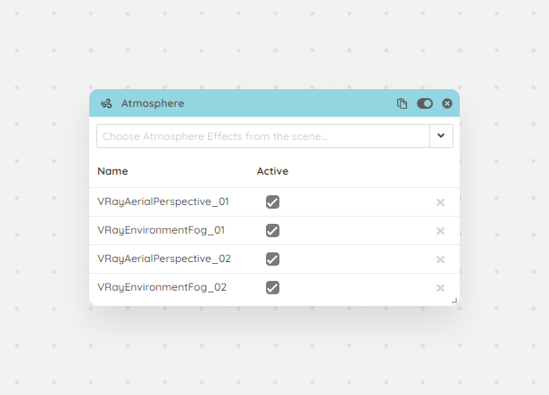

With the Atmosphere module you can take control over 3ds Max Atmosphere Effects, like `VRayAerialPerspective` or `VRayEnvironmentFog`. After choosing the required ones from the dropdown you can take control over them and enable/disable these effects per setup.

<Frame caption="Atmosphere module">
  
</Frame>
