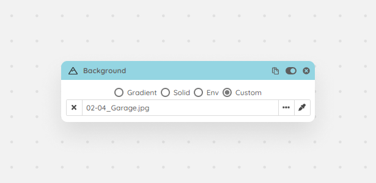

This module controls your active viewport's background. You can choose between Gradient, Solid, Environment and Custom. The custom option will let you browse a background image, which can be handy in case you want to do photo matching for multiple cameras.

<Frame caption="Background module">
  
</Frame>
