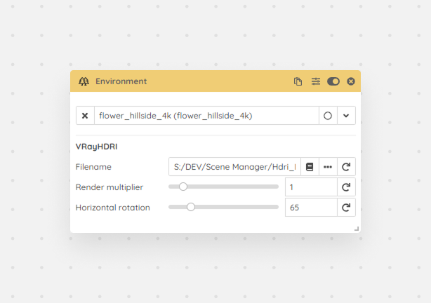

The environment is None by default. If you have a valid Sun object you can choose to have a Sky map, if you have an HDRI loaded you can load it into the environment from here, or if you need more specific control you can choose Custom.

<Frame caption="Environment module">
  
</Frame>
