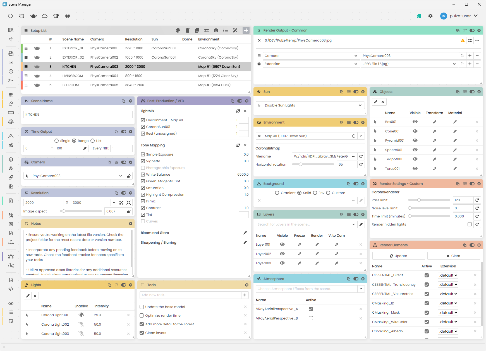

All possible settings are categorized and grouped into modules. You can show/hide and drag around these modules to create the most ideal UI that you need for your current project.

<Frame caption="Scene Manager modules overview">
  
</Frame>
