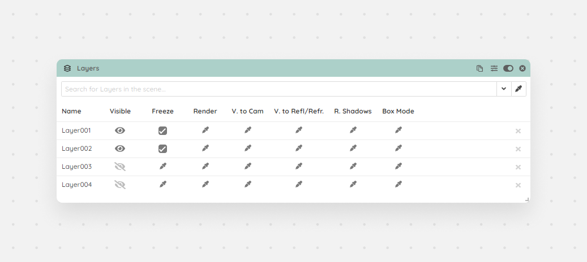

There are multiple ways to add your layers: you can search or select them from the dropdown, or by selecting the layers in max you can load them in by pressing the fetch button.

<Frame caption="Layers module">
  
</Frame>
