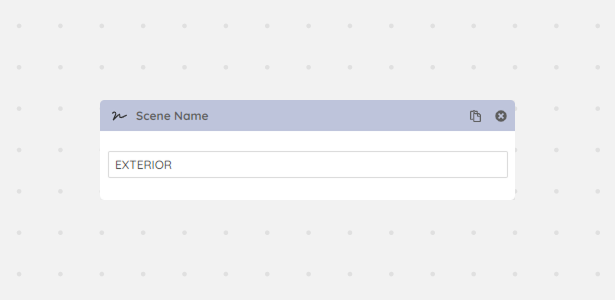

After a certain complexity PhysCamera001, PhysCamera002 doesn't mean a lot. With the Scene Name module you can add a more defined name for your scene setup.

<Frame caption="Scene Name module">
  
</Frame>
