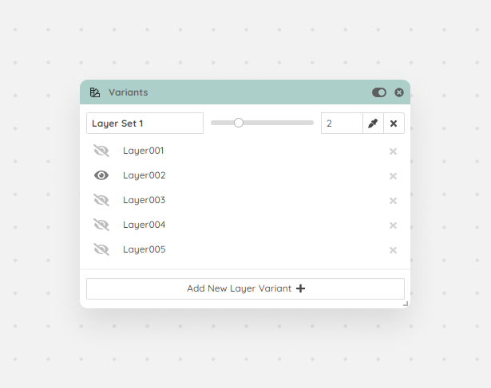

You can define a list of layers where each item will represent a version of a product. This way you can easily create and render hundreds of variations within one state. Perfect solution if you are doing product renderings.

<Frame caption="Variants module">
  
</Frame>
