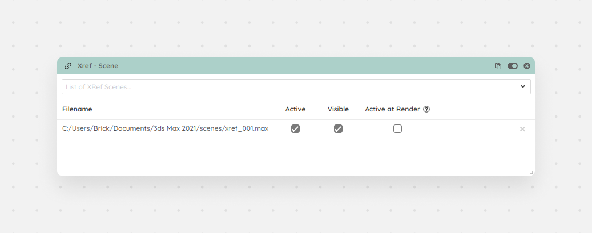

The Xref Scene module will let you select files that are loaded into your scene. You can enable/disable and set the visibility of these files per setup.

<Frame caption="Xref Scene module">
  
</Frame>
